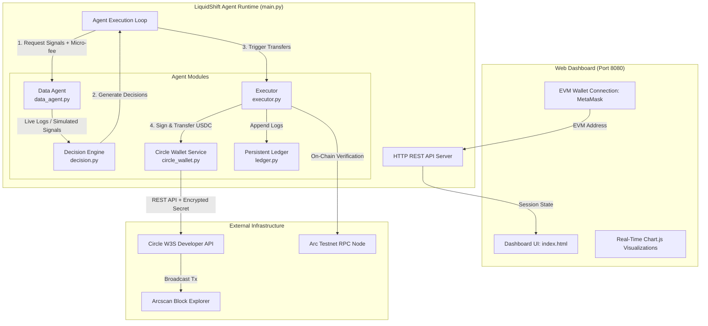

# LiquidShift 🌊

**Autonomous USDC Liquidity Reallocation Agent on Arc Testnet powered by Circle Programmable Wallets.**

[](https://www.python.org/)
[](https://testnet.arcscan.app)
[](https://developers.circle.com/w3s)
[](LICENSE)

---

## 📌 Overview

**LiquidShift** is an autonomous, agentic DeFi liquidity management system designed for **Arc Testnet**. It continuously monitors yield, volume, and depth across decentralized liquidity pools, automatically reallocating USDC to maximize yield while benchmarking active agent returns against a passive equal-weight strategy.

LiquidShift leverages **Circle Programmable Wallets (Developer-Controlled Wallets)** to execute on-chain reallocations safely and autonomously without exposing raw private keys, with complete fallback simulation support for offline development.

---

## 🚀 Key Features

- **🤖 Autonomous Decision Engine**: Evaluates pool yield differentials (`1h volume / pool liquidity`), checks rebalance cooldown thresholds, and executes optimal capital migrations.
- **🔐 Circle Programmable Wallets**: Uses Circle Developer-Controlled Wallets with RSA-OAEP encrypted entity secret authorization for secure, keyless on-chain transfers on Arc Testnet.
- **🔄 Dual Execution Modes**:
  - **Live Mode**: Submits real USDC transactions on Arc Testnet via Circle's W3S API.
  - **Simulated Mode**: Automatically activates if Circle credentials are not provided, simulating wallet creation, transfers, and deterministic state transitions.
- **🛰️ Multi-Agent Architecture**:
  - **Data Agent**: Continuously gathers pool signals using on-chain swap events or realistic multi-frequency stochastic models (incorporating daily seasonal drift, volatility spikes, and weekend cycles). Deducts a micro-fee (`0.0001 USDC`) per cycle.
  - **Decision & Execution Agent**: Allocates nominal capital (`$10,000` default) while enforcing safety guardrails (`TESTNET_MAX_TX_USDC` cap) to protect testnet funds.
- **📊 Real-Time Interactive Dashboard**:
  - Dynamic **Chart.js** doughnut chart for active capital allocation.
  - Interactive **Active vs. Passive (Benchmark)** earnings time-series with zoom controls.
  - Live pool signals, volume bar indicators, and live/simulated source badges.
  - Complete decision and execution ledger with direct links to [Arcscan Explorer](https://testnet.arcscan.app).
  - Web3 wallet integration (MetaMask, Rabby, etc.) mapped directly to Circle wallet sessions.

---

## 🏗️ Architecture



---

## 📂 Project Structure

```
liquidshift/
├── agent/                      # Core agent logic and backend server
│   ├── circle_wallet.py        # Circle Programmable Wallets client & encryption
│   ├── config.py               # Environment configuration and parameter defaults
│   ├── connect.py              # Arc testnet RPC & USDC verification utility
│   ├── data_agent.py           # On-chain event queries & stochastic pool feed
│   ├── decision.py             # Yield heuristic evaluation & decision models
│   ├── executor.py             # Transaction execution & testnet guardrails
│   ├── ledger.py               # Atomic thread-safe decision/transaction logging
│   ├── main.py                 # Agent orchestration loop & HTTP dashboard server
│   └── wallet.py               # Web3 RPC provider & balance checker
├── dashboard/                  # Frontend web interface
│   ├── assets/
│   │   └── favicon.png         # Project branding & favicon
│   ├── index.html              # Modern dark-mode dashboard markup
│   ├── script.js               # Reactive client logic, Chart.js, & ethers.js
│   └── styles.css              # Glassmorphic, tailored dark-mode stylesheets
├── data/
│   └── ledger.json             # Runtime execution history (auto-generated)
├── .env.example                # Template for environment variables
├── requirements.txt            # Python dependencies
└── README.md                   # Project documentation
```

---

## 🛠️ Prerequisites & Setup

### 1. Requirements
- **Python**: Version `3.10` or higher
- **Node/Browser**: Any modern browser with an EVM wallet extension (e.g. MetaMask)

### 2. Installation

Clone the repository and install dependencies in a virtual environment:

```bash
# Clone the repository
git clone https://github.com/seyoj7/liquidshift.git
cd liquidshift

# Create and activate virtual environment
python -m venv .venv

# Windows:
.venv\Scripts\activate
# Linux/macOS:
# source .venv/bin/activate

# Install required dependencies
pip install -r requirements.txt
```

---

## ⚙️ Configuration

Copy the example environment configuration:

```bash
cp .env.example .env
```

### Environment Variables Breakdown

| Variable | Required | Default | Description |
| :--- | :---: | :---: | :--- |
| `ARC_TESTNET_RPC_URL` | Yes | `https://rpc.testnet.arc.network` | Arc Testnet JSON-RPC endpoint |
| `USDC_CONTRACT_ADDRESS` | Yes | `0x3600000000000000000000000000000000000000` | Native USDC contract on Arc Testnet |
| `CIRCLE_API_KEY` | Optional | `""` | Circle developer console API key |
| `CIRCLE_ENTITY_SECRET` | Optional | `""` | 32-byte hex-encoded Circle entity secret |
| `CIRCLE_WALLET_SET_ID` | Optional | `""` | Target Circle developer wallet set ID |
| `CIRCLE_ARC_USDC_TOKEN_ID` | Optional | `""` | Circle token identifier for USDC on Arc |
| `AGENT_LOOP_INTERVAL_S` | No | `30` | Seconds between agent rebalance cycles |
| `MODEL_CAPITAL_USDC` | No | `10000` | Nominal capital modeled for yield tracking |
| `TESTNET_MAX_TX_USDC` | No | `0.01` | Maximum USDC transferred per live testnet tx |
| `DASHBOARD_PORT` | No | `8080` | Local HTTP server port for the dashboard |
| `CURVE_POOL_ADDRESS` | No | `""` | Curve on Arc pool address (enables live logs) |
| `XYLONET_POOL_ADDRESS` | No | `""` | XyloNet pool address (enables live logs) |
| `DEFIONARC_POOL_ADDRESS` | No | `""` | DefiOnARC pool address (enables live logs) |

---

## 🚦 Verification & Running

### Step 1: Verify Arc Testnet Connection
Test RPC connectivity and USDC contract availability:
```bash
python agent/connect.py
```

### Step 2: Test Wallet Client
Check Circle wallet status and balance resolution:
```bash
python agent/wallet.py
```

### Step 3: Launch LiquidShift Agent & Dashboard
Start the autonomous loop and dashboard web server:
```bash
python agent/main.py --interval 30 --port 8080
```

Open your browser and navigate to:
```
http://localhost:8080
```

---

## 🖥️ Dashboard Walkthrough

1. **Connect Wallet**: Click **"Connect Wallet"** in the top navigation bar to connect your EVM wallet (MetaMask). The backend automatically registers a corresponding Circle wallet session.
2. **Circle Faucet**: Click **"Faucet ↗"** to get testnet USDC from the official Circle faucet.
3. **Start Agent**: Click the **"Start"** button to initiate autonomous cycles for your session.
4. **Monitor Analytics**:
   - **Wallet Balance**: Real-time on-chain balance of the active wallet.
   - **Capital Allocation Chart**: Live breakdown of capital across pools and idle reserves.
   - **Active vs. Passive Earnings**: Dynamic line chart comparing the agent's active allocation yield against a passive equal-weight benchmark.
   - **Decision Log**: Complete audit trail showing reallocation rationale, execution status, and transaction hashes.

---

## 🔒 Security & Safe Execution Guardrails

- **Keyless Architecture**: Uses Circle Programmable Wallets with RSA-OAEP encrypted secrets; no raw private keys are stored on disk.
- **Testnet Guardrail Cap**: Real testnet transactions are capped at `TESTNET_MAX_TX_USDC` (`0.01 USDC`) per operation, avoiding rapid depletion of testnet faucet balances while modeling large portfolio allocations.
- **Rebalance Cooldown**: Built-in 15-second minimum interval between capital movements to avoid friction losses and high churn.

---

## 📄 License

[MIT License](LICENSE)
